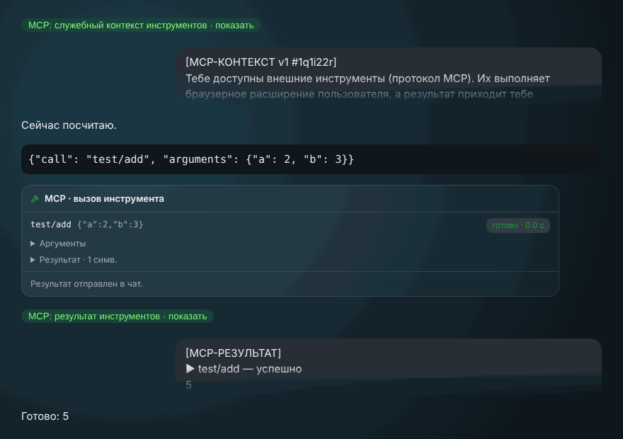
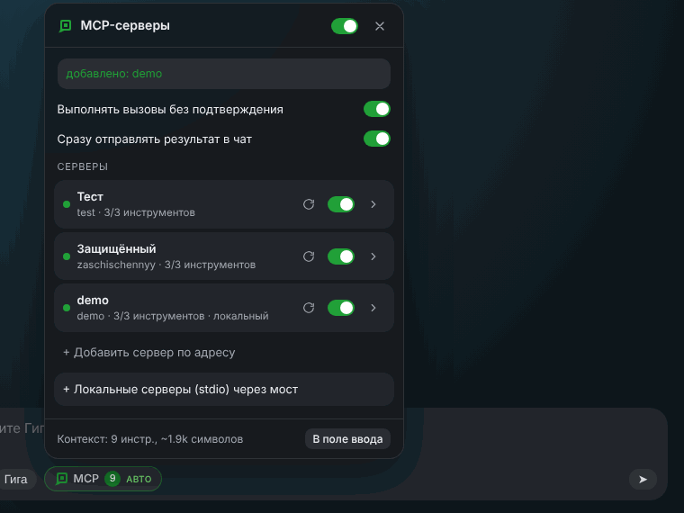

<p align="center">
  <picture>
    <source media="(prefers-color-scheme: dark)" srcset="brand/gigamcp-logo-dark.svg">
    
  </picture>
</p>

<p align="center">
  <b>MCP-инструменты прямо в ГигаЧате.</b><br>
  Расширение Chrome, которое подключает MCP-серверы к <a href="https://giga.chat">giga.chat</a>.
</p>

<p align="center">
  <a href="LICENSE"></a>
  <a href="https://github.com/VolkovIlia/gigamcp/actions/workflows/test.yml"></a>
  
  
</p>

Рядом с полем ввода в giga.chat появляется кнопка **MCP**. В ней вы подключаете MCP-сервер по адресу, и ГигаЧат начинает вызывать его инструменты по ходу разговора: читает задачи, ищет в базе, работает с файлами — со всем, что умеет сервер.

> Неофициальный проект. Не связан со Сбером и командой ГигаЧата. «ГигаЧат» и «GigaChat» — товарные знаки их владельцев.

*English:* GigaMCP is an unofficial open-source Chrome extension that brings Model Context Protocol (MCP) tool servers to the GigaChat web UI (giga.chat). Add a server by URL (Streamable HTTP or SSE, bearer token or OAuth 2.1), or run local stdio servers through the bundled bridge. MIT licensed.

<p align="center">
  
</p>

## Возможности

- **Серверы по адресу:** Streamable HTTP и старый HTTP+SSE (откат происходит сам).
- **Авторизация:** без неё, Bearer-токен или OAuth 2.1 со своим окном входа, как у коннекторов claude.ai: обнаружение сервера авторизации, динамическая регистрация клиента, PKCE.
- **Локальные stdio-серверы** (`npx`, `uvx` и т. п.) через маленький мост на Node без зависимостей, конфиг в формате Claude Desktop.
- **Подтверждение вызовов:** у каждого вызова карточка с кнопками «Выполнить» и «Отклонить», есть авто-режим с защитой от бесконечного цикла.
- **Выбор инструментов:** лишние можно выключить галочками. Для больших серверов включается сжатый каталог.
- **Аккуратная история:** служебные сообщения в чате сворачиваются в плашки.

## Установка

1. Скачайте `gigamcp-extension-vX.Y.Z.zip` со страницы [Releases](https://github.com/VolkovIlia/gigamcp/releases) и распакуйте его.
2. Откройте `chrome://extensions` и включите **Режим разработчика**.
3. Нажмите **Загрузить распакованное расширение** и выберите распакованную папку (в ней лежит `manifest.json`).
4. Откройте или обновите вкладку giga.chat: внизу поля ввода, рядом с «Гига», появится кнопка **MCP**.

Из исходников: склонируйте репозиторий и выберите папку `extension`.

ID расширения постоянный — `mmjnppnijhblimofghdejjdhfgdjgcol`, поэтому при переустановке не меняется и адрес возврата для OAuth.

## Подключение серверов



Нажмите **MCP → Добавить сервер по адресу**.

| Сервер | Что выбрать |
|---|---|
| Открытый | «Без авторизации» |
| С API-ключом | «Токен (Bearer)» |
| Со входом | «Определить автоматически». Откроется окно входа сервера; если там просят код подтверждения, введите его прямо в окне |
| Без динамической регистрации клиентов | «Свой client_id», адрес возврата `https://mmjnppnijhblimofghdejjdhfgdjgcol.chromiumapp.org/oauth` |

### Локальные stdio-серверы

Браузер не умеет запускать программы, поэтому для stdio-серверов есть мост (нужен Node 18+):

```bash
cd bridge
cp servers.example.json servers.json   # формат как у Claude Desktop
node gigamcp-bridge.mjs --config servers.json
```

Мост покажет адрес (`http://127.0.0.1:3939`) и токен. В панели откройте **Локальные серверы (stdio) через мост**, вставьте их и нажмите «Импортировать»: появятся все серверы из конфига.

<br clear="right">

## Как это работает

В веб-версии ГигаЧата нет прямого вызова функций, поэтому расширение договаривается с моделью текстом:

1. К первому сообщению в чате добавляется служебный блок `[MCP-КОНТЕКСТ]` со списком инструментов и правилами.
2. Чтобы вызвать инструмент, модель пишет блок кода ` ```mcp ` с JSON: `{"call": "сервер/инструмент", "arguments": {…}}`.
3. Под ответом появляется карточка вызова. Фон расширения обращается к MCP-серверу.
4. Результат уходит в чат сообщением `[MCP-РЕЗУЛЬТАТ]`, и модель продолжает работу.

Вызовы из старых сообщений сами не запускаются никогда. В авто-режиме допускается не больше 12 шагов подряд без участия человека.

```
extension/
  background.js        фон: серверы, подключения, OAuth, вызовы
  lib/mcp-client.js    MCP-клиент (Streamable HTTP + SSE), без зависимостей
  lib/oauth.js         OAuth 2.1: RFC 9728 / 8414 / 7591, PKCE, resource indicator
  content/protocol.js  текстовый протокол: контекст, разбор вызовов, результаты
  content/content.js   интерфейс в giga.chat: кнопка, панель, карточки
bridge/                мост stdio → HTTP
brand/                 логотип и правила его использования
test/                  тесты: клиент, OAuth, мост, протокол, e2e в Chromium
```

Все селекторы вёрстки giga.chat собраны в объекте `SEL` в начале `content/content.js`. Если интерфейс ГигаЧата изменится, править нужно только там.

## Ограничения

- Служебный контекст и результаты остаются в истории чата (в свёрнутом виде) и занимают часть контекстного окна модели.
- Результаты передаются только текстом: картинки и аудио заменяются пометкой.
- Сервер не может обращаться к клиенту: sampling и elicitation не поддерживаются.
- В поле ввода giga.chat помещается до 100 000 символов. Если каталог инструментов очень большой, выключите лишние.

## Безопасность

Расширение просит доступ ко всем адресам (`<all_urls>`), чтобы обращаться к MCP-серверам по любому адресу без ограничений CORS. Интерфейс встраивается только в giga.chat. Токены хранятся в `chrome.storage.local` вашего браузера и никуда, кроме самих серверов, не отправляются. Подробнее — в [SECURITY.md](SECURITY.md).

## Разработка

```bash
cd test && npm install
node node-tests.mjs   # MCP-клиент, OAuth, мост, протокол
npm i --no-save playwright && npx playwright install chromium
node e2e.mjs          # настоящее расширение в Chromium + макет giga.chat
```

Как помочь проекту — в [CONTRIBUTING.md](CONTRIBUTING.md). История изменений — в [CHANGELOG.md](CHANGELOG.md).

## Лицензия

[MIT](LICENSE) © 2026 Ilia Volkov. Логотип распространяется на тех же условиях, правила его использования — в [brand/README.md](brand/README.md).
